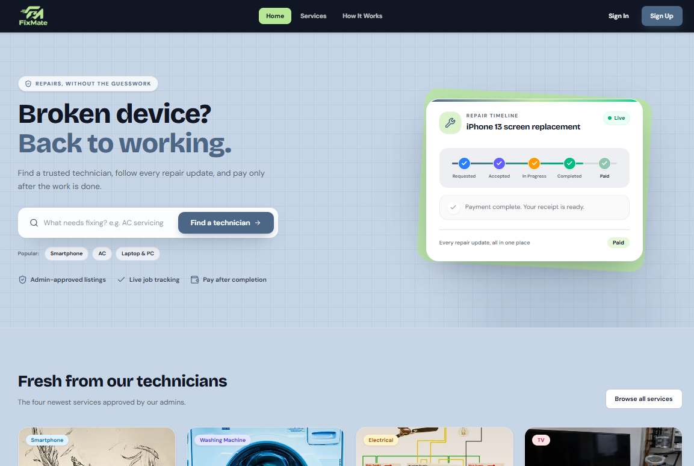
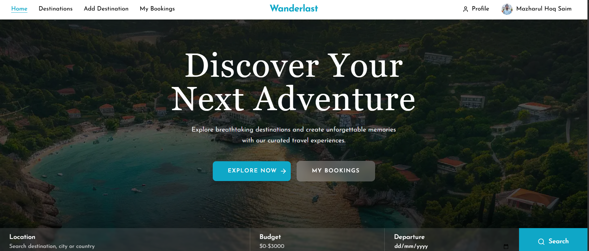
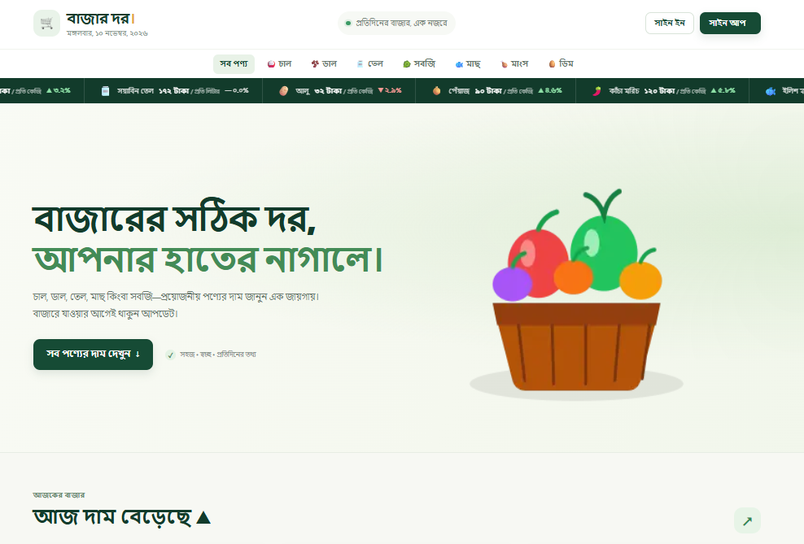
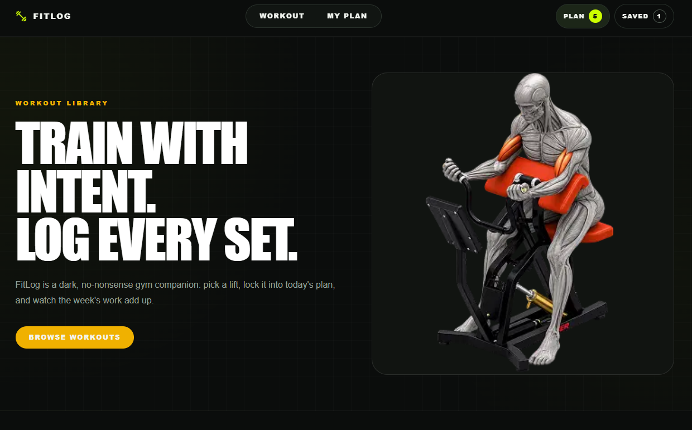

# mhbs.portfolio

Personal portfolio website of **Mazharul Hoq Bhuiyan Saim** — AI-driven full-stack web engineer, built with a modern dark terminal-inspired design featuring a monospace aesthetic, vivid green accent, and smooth page transitions.

## Technologies Used

| Category | Technologies |
| --- | --- |
| Framework | [Next.js 16](https://nextjs.org) (App Router, Turbopack, SSG) |
| UI Library | [React 19](https://react.dev) |
| Language | TypeScript |
| Styling | [Tailwind CSS v4](https://tailwindcss.com), [shadcn/ui](https://ui.shadcn.com) |
| Fonts | Geist Mono (via `next/font`) |
| Icons | [lucide-react](https://lucide.dev), [react-icons](https://react-icons.github.io/react-icons) (Simple Icons / Tabler / Feather) |
| Images | `next/image` optimization |
| Hosting | Vercel |

## Main Features

- **Interactive hero section** — circular profile photo with animated dashed orbit rings, designation, bio, and one-click resume download.
- **Multi-page experience** — dedicated routes for Home, Expertise, About me (tabs: About / Experience / Education / Skills / Achievements), Projects, and Contact.
- **Expertise showcase** — 6 numbered skill cards with real skill tags, split into 4 web-engineering areas + 2 specialized strengths.
- **Categorized skills grid** — dark icon-tile grid with real brand logos (react-icons + official brand logos for Node.js, Express.js, Better Auth, JWT, CRUD, shadcn/ui, and Stripe), proficiency bars, grouped by Frontend / Backend & Data / Tools & Platforms.
- **Projects gallery** — 7 live projects with screenshots, tech stacks, categories, and counters.
- **Project detail pages** — statically generated (`SSG`) per-project pages with descriptions, challenges, and future improvements, fully SEO-tagged via `generateMetadata`.
- **AI chatbot widget** — floating assistant ("?") that answers questions about projects, skills, experience, and contact info.
- **Page transition animation** — staggered panel veil that sweeps on every route change (with `prefers-reduced-motion` fallback).
- **Scroll reveal animations** — staggered content entrances across all pages.
- **Fully responsive** — mobile drawer navigation, adaptive hero, and responsive grids throughout.
- **One-click resume download** — available in the navbar, hero section, and mobile drawer.

## Featured Projects

### 🛠️ FixMate — Full-Stack Device Repair Marketplace

FixMate is an end-to-end device repair marketplace connecting customers with vetted repair technicians. Customers can browse and book repair services with search and multi-criteria filters, follow repair progress through a live status workflow, and pay securely via Stripe after service completion with downloadable PDF invoices. Technicians manage their service catalogues subject to admin approval, while administrators moderate users, services, and bookings through role-specific dashboards.

- **Live URL:** [https://fixmate-alpha.vercel.app](https://fixmate-alpha.vercel.app)
- **Client Repository:** [https://github.com/mhbsaim04/fixmate-client](https://github.com/mhbsaim04/fixmate-client)
- **Server Repository:** [https://github.com/mhbsaim04/fixmate-backend](https://github.com/mhbsaim04/fixmate-backend)

#### Key Features
- **Role-Based Authentication:** Customer, technician, and admin roles with email/password and Google OAuth (BetterAuth + JWT).
- **Service Marketplace:** Dynamic search, category filters, service modes (mail-in / carry-in / on-site), sorting, and pagination.
- **Technician Service Management:** Service listing creation with image upload (ImgBB) and admin approval/rejection moderation workflow.
- **Booking Lifecycle:** Real-time repair status tracking with live technician milestone updates.
- **Secure Stripe Payments:** Pay-after-service model with automated downloadable PDF invoice generation via jsPDF.
- **Role-Specific Dashboards:** Dedicated dashboard interfaces for customers, technicians, and platform admins.
- **Reviews & Ratings:** Service ratings and customer feedback system.
- **Notification Bell:** User alerts for interactions, repair status shifts, and booking updates.
- **Responsive UI:** Modern component architecture crafted with Tailwind CSS v4 and shadcn/ui (Radix / Base UI).

#### Tech Stack
- **Frontend:** Next.js 16 (App Router), React 19, TypeScript, Tailwind CSS 4, shadcn/ui, Radix UI, Base UI, Framer Motion, Lucide Icons, Sonner
- **Backend & Authentication:** BetterAuth (MongoDB adapter, JWT, Google OAuth), REST API, MongoDB
- **Payments & Utilities:** Stripe, ImgBB, jsPDF, Recharts, Embla Carousel, React Hook Form, Zod

---

### 🎨 StudioSpace — Creative Studio Sharing Platform

Peer-to-peer marketplace for booking photo studios, sound stages, podcast lounges, and workshops by the hour, with host approvals and server-enforced double-booking prevention.

- **Live URL:** [https://studiospace-marketplace-steel.vercel.app](https://studiospace-marketplace-steel.vercel.app)
- **Client Repository:** [https://github.com/mhbsaim04/studiospace-platform](https://github.com/mhbsaim04/studiospace-platform)
- **Server Repository:** [https://github.com/mhbsaim04/studiospace-backend-server](https://github.com/mhbsaim04/studiospace-backend-server)
- **Tech Stack:** Next.js 16, React 19, Tailwind CSS v4, shadcn/ui, Express 5, MongoDB Atlas, Better Auth (JWT)

---

### ✈️ Wanderlast — Travel Booking Webapp

A full-stack travel booking platform where travelers search destinations, explore curated trip packages, and book instantly with JWT authentication.

- **Live URL:** [https://wanderlast-travel-booking-webapp.vercel.app](https://wanderlast-travel-booking-webapp.vercel.app)
- **GitHub Repository:** [https://github.com/mhbsaim04/wanderlast-travel-booking-webapp](https://github.com/mhbsaim04/wanderlast-travel-booking-webapp)
- **Tech Stack:** Next.js (App Router), React, TypeScript, Tailwind CSS v4, Express.js, MongoDB, Better Auth (JWT)

---

### 📊 Bazar Dor — Commodity Price Tracker

Bengali-language market-price dashboard for everyday products across Bangladesh featuring price movers, sorting, and authenticated market insights.

- **Live URL:** [https://bazar-dor-web-project.vercel.app/](https://bazar-dor-web-project.vercel.app/)
- **GitHub Repository:** [https://github.com/mhbsaim04/bazar-dor-web-project](https://github.com/mhbsaim04/bazar-dor-web-project)
- **Tech Stack:** Next.js App Router, React 19, TypeScript, Tailwind CSS v4, Better Auth, MongoDB, OAuth

---

### 🏋️ FitLog — Workout Library & Daily Training Planner

Interactive workout library and daily training planner with a 12-workout catalogue, capped 5-lift daily plans, and persistent local tracking.

- **Live URL:** [https://body-fit-log-web.vercel.app](https://body-fit-log-web.vercel.app)
- **GitHub Repository:** [https://github.com/mhbsaim04/body-fit-log-web](https://github.com/mhbsaim04/body-fit-log-web)
- **Tech Stack:** Next.js 16, React 19, TypeScript, Tailwind CSS v4, Lucide Icons, React Hot Toast

---

© 2026 Mazharul Hoq Bhuiyan Saim. All rights reserved.
